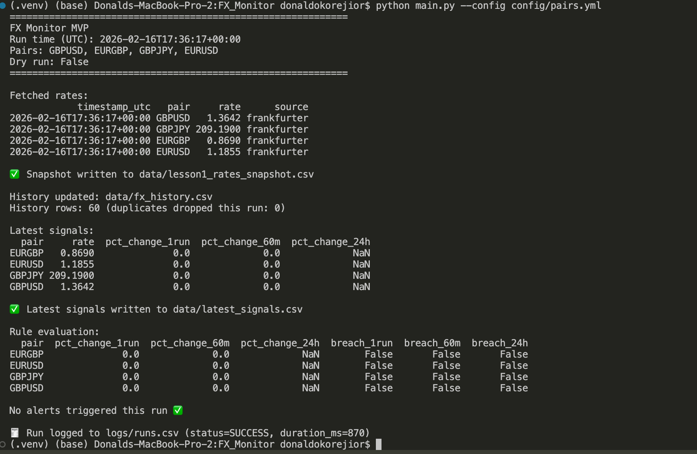

# FX Monitor

A config-driven monitoring tool for FX rates and gold. It flags material price moves against per-pair thresholds, and emails a scheduled market update (default 3pm and 10pm) with a gold headline.

Built originally to send gold price updates to a friend getting into trading, then extended into a tested, auditable pipeline.



---

## Business question

Have any monitored pairs moved beyond agreed thresholds, so that someone needs to act (hedge, reprice, escalate)?

Risks the design addresses:
- **Volatility risk:** moves are measured over three windows, not one.
- **Operational risk:** scheduled runs mean a move is not missed.
- **Data risk:** bad rates are rejected before they can cause a false alert.

---

## What it does

- Fetches FX rates from Frankfurter and gold (XAU/USD) from Yahoo Finance (COMEX futures, `GC=F`). No API keys needed.
- Validates every rate before it is stored.
- Appends each observation to a CSV time series (append-only, so history is never overwritten).
- Computes movement signals and applies per-pair thresholds from config.
- Suppresses repeat alerts for the same pair and breach inside a cooldown window.
- Sends an email update by SMTP: gold price, 24h move with short commentary, FX moves and any alerts.
- Logs every run (status, duration, alert counts) and every alert, so each alert can be traced.
- Includes a Streamlit dashboard for viewing rates, history, signals and the alert log.

```
Fetch rates -> Validate -> Store history -> Compute signals -> Apply rules -> Build alerts -> Email -> Log run
```

---

## Signals and alert logic

| Signal | Meaning | Severity |
|---|---|---|
| `pct_change_1run` | % change vs the previous observation | LOW |
| `pct_change_60m` | % change vs the latest reading at least 60 minutes old | MED |
| `pct_change_24h` | % change vs the latest reading at least 24 hours old | HIGH |

An alert fires when `ABS(signal)` is above the pair's configured threshold for that window.

Example: GBPJPY moved up 0.62% over 60 minutes against a 0.50% threshold, giving an ALERT [MED].

---

## Setup

```bash
python -m venv .venv
source .venv/bin/activate
pip install -r requirements.txt

cp config/pairs.example.yml config/pairs.yml
# edit pairs.yml: choose pairs and thresholds
```

### Email credentials (environment variables)

No credentials are stored in the repo. `config/pairs.yml` only contains `${VARIABLE}` placeholders, which are filled from your environment at run time.

```bash
export SMTP_HOST=smtp.gmail.com
export SMTP_PORT=587
export SMTP_USER=you@example.com
export SMTP_PASSWORD=your_app_password      # Gmail: use an App Password, not your login password
export EMAIL_RECIPIENT_1=first@example.com
export EMAIL_RECIPIENT_2=second@example.com
```

---

## Running

```bash
python main.py                              # single run
python main.py --interval 5                 # repeat every 5 minutes
python main.py --schedule 15:00,22:00       # run daily at these local times
python main.py --dry-run                    # do not write data or log files (still sends the email)
python main.py --config config/pairs.yml    # choose a config file
```

`--schedule` uses your system's local time. The process must stay running (for example in a terminal, `tmux`, or a service) for scheduled sends to fire.

Dashboard:

```bash
streamlit run dashboard.py
```

---

## Outputs

| File | Contents |
|---|---|
| `data/fx_history.csv` | Every validated observation (append-only) |
| `data/latest_signals.csv` | Most recent signals snapshot |
| `logs/alerts.csv` | Every alert that fired |
| `logs/runs.csv` | Execution audit log |

These files are gitignored.

---

## Project structure

```
config/        pairs.example.yml (template; copy to pairs.yml)
src/           fetch_rates, validate, store, compute_signals, rules, alert, notify, run_log
tests/         pytest unit tests
main.py        pipeline orchestrator and scheduler
dashboard.py   Streamlit dashboard
```

Design principles: config-driven behaviour, secrets from environment variables, append-only audit trails, small testable pipeline stages.

---

## Tests

```bash
pip install pytest
pytest tests/ -v
```

Unit tests cover rate validation, signal computation, threshold rules and alert building.

---

## Limitations

- Gold uses COMEX futures (`GC=F`), not the spot price, and Yahoo Finance data is free and unofficial, so treat it as indicative.
- The scheduler runs inside the Python process. A restart or a sleeping laptop skips scheduled sends.
- Alert commentary in the email is rule-based text, not a forecast.
- This is a monitoring tool, not trading advice.